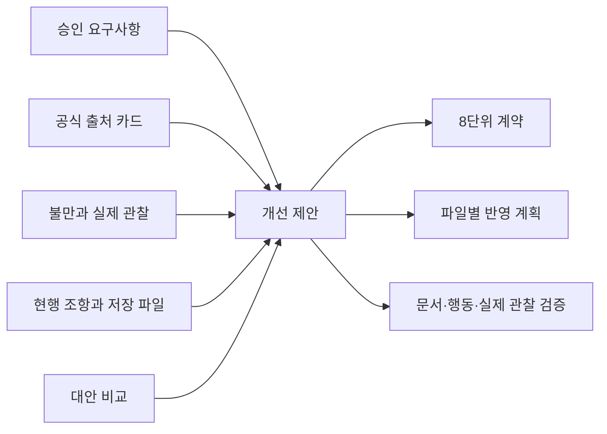

# 검토 문서 항목의 관계

상태: 계획 검토용. 아래는 Markdown의 정적 항목/참조를 설명한다. DB·LMS·진도 스키마·앱 모델·migration·API 데이터 구조가 아니다. 학습자 점수·이력·누적 시간·자동 다음 목표를 저장하지 않는다. 현재 위치는 기존 `STATE.md`만 관리한다.

## 항목과 필드

| 문서 항목 | 필드의 의미 | 기준 위치·검증 |
| --- | --- | --- |
| Requirement | 승인 FR 식별자·검토 대상·성공 기준 대응 | `spec.md` 원문 보존. FR-001~038의 누락/변경 없이 추적표에서 대응. |
| UnitAudit | 기존 AX/RE ID·현행 목적·제안 상태·목표 연결·입출력/흐름·직접 행동·최소 선수/사용처·보강·소유권·최소 산출물·평가/실패·연구 연결·미확인 | `contracts/unit-audit.md`. 기존 8개와 1:1 대응. 변경/분할하더라도 원 ID 연결을 잃지 않음. |
| SourceCard | 기관/과정·판본/개정 상태·공식 URL·구간·조회일·관찰·적용 해석·한계·9관점의 확인 상태 | `evidence/plan-source-supplement.md`. 확인/부분/미확인 구분, 기관 중복 집계 금지. |
| ComplaintObservation | 사용자 발언/판단·U/F 근거·실제 진행·원인 가설/미확인·개선 가설·O/D/E 분류·관찰/실패 기준 | 기존 `evidence/local-observations.md`를 보존하고 `contracts/tutoring-flow.md`에서 대응. 원인을 학습자 능력으로 단정하지 않음. |
| AlternativeComparison | 같은 목적·대안·관점별 이점/비용·전환/유지 조건·선택/제외 이유·미측정 | `research.md`. 실습 3×14, 저장소 5전략/5×9. 확장자/개수로 효과·숙달을 대신 판단하지 않음. |
| Proposal | R 또는 U 참조·근거·불만/관찰·현행 조항·저장 파일·판단/이유·대상 반영 위치·검증 행동·실패/미확인 | `evidence/proposal-traceability.md`. 최종 제안은 연결의 공란 없이 작성, 무관은 이유 표시. |
| EvidenceBoundary | 제공/기존/튜터 지원·문서/API/개념 도움·학습자 작성·실행·첫 해석·독립/지연 확인·실패/미실행의 구분 | 기존 산출물/STATE의 도움 표시 보존, 튜터 계약에서 의미 정의. 새 시도 DB/점수표를 만들지 않음. |
| ValidationScenario | V-A/B/C 종류·전제·행동·기대 관찰·실패/재검토·미실행 기준·실제 확인 범위 | `quickstart.md`. 계획 검증·합성 행동·실제 재개 관찰을 서로 대체하지 않음. |
| FileDisposition | 경로·권위 역할·지금 보존/작성·승인 후 변경/유지·보존 부분·의존/적용 순서·회귀 확인 | `plan.md`. 운영 반영은 계획 승인 후 별도 tasks/implement. |

식별자는 정적 문서 참조이며 학습자 성과/진도 키가 아니다. 기존 catalog/registry ID를 재사용/완료 환산하지 않는다. 제안 수가 많아도 새 데이터 시스템의 필요를 뜻하지 않는다.

## 관계와 무결성

- 한 제안은 여러 요구/출처/불만/검증에 연결될 수 있다. 제안마다 공식 방법의 적용 범위·반대 근거/한계를 설명한다. 기관 이름만 붙인 연결은 무효다.
- UnitAudit의 선수는 의존하는 직접 작업에 연결한다. 수학·공식 과목 전체를 자동 선행 gate로 만들지 않는다.
- 동일 문의/질의의 반복은 같은 독립 사례 안의 반복 시도다. corpus와 평가 질의/qrels, fit/개발 선택과 최종 평가의 관계를 혼동하지 않는다.
- 도움·작성·실행·해석은 서로 독립된 근거 차원이다. 제공 코드의 실행은 학습자 작성이 아니며, 형식 pass도 내용/목적 충분성 pass가 아니다.
- 실제 저장 근거가 없는 경우 참조를 꾸미지 않고 `미확인`과 확인할 행동을 둔다. 원자료/private·출력 사후 생성으로 공란을 채우지 않는다.
- 기준 문서의 역할은 STATE/ROADMAP/CURRICULUM/DEFERRED/실행 지침으로 유지한다. feature 문서는 감사/설계 근거이지 새 현재 북마크가 아니다.

## 제안·검증·승인의 상태

문서상 상태는 `후보 → 비교/근거 검토 → 계획 제안 → 사용자 계획 검토 → 승인 또는 수정/기각`이다. 승인되면 후속 tasks/implement에서 운영 문서 반영/검증을 수행한다. 이 파일이 엔진 상태를 변경하거나 자동 승인하지 않는다.

학습 효과는 별도다. `실제 재개 요청 → 사전 기준을 둔 활동 → 직접 코드/실행/첫 해석 관찰 → 유지/수정/기각 판단`으로 확인한다. 실행하지 않았다면 미수행, 실제 결과가 나빴다면 부정 결과, 조건이 달라 비교할 수 없다면 비교 제한으로 나눈다. 문서 승인에서 실제 효과 성공으로 자동 전이하지 않는다.

현재 명세 승인은 완료됐고 계획 승인은 대기다. 기존 체크리스트/초기 근거의 명세 작성 당시 상태 문구는 역사적 기록으로 보존하며 최신 승인 인계보다 우선하는 현재 상태로 읽지 않는다. 이 command의 종료가 엔진 paused를 직접 확인한 사실은 아니다.
